<a href="https://yusufkemalpinarci.github.io">
  
</a>

  
  
  

 

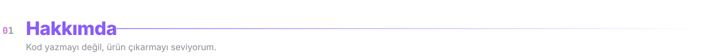
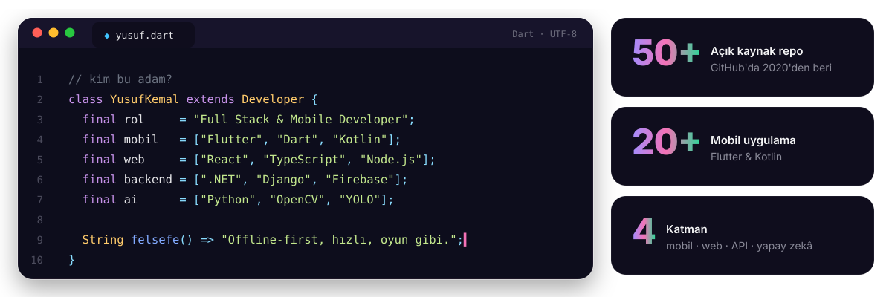

 

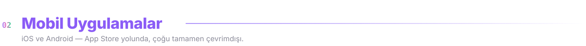

<table align="center">
  <tr>
    <td align="center" width="25%"> <b>Prompter</b> Konuşma provası ve teleprompter</td>
    <td align="center" width="25%"> <b>Bant</b> Notu sesin o saniyesine bağlayan kayıt</td>
    <td align="center" width="25%"> <b>Sohbet Karnesi</b> Sohbetinden paylaşılabilir karne</td>
    <td align="center" width="25%"> <b>Gridline</b> Her gün dört mantık bulmacası</td>
  </tr>
  <tr>
    <td align="center" width="25%"> <b>Elixir Sort</b> Simyalı sıralama bulmacası</td>
    <td align="center" width="25%"><a href="https://fikstur.albovix.com">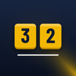</a> <b>Fikstür</b> Fikstür, puan durumu, takım kurma</td>
    <td align="center" width="25%"> <b>Serbest Saat</b> Saat takibi ve PDF fatura</td>
    <td align="center" width="25%"> <b>Tahsildar</b> Muhasebe bürosu cari takip</td>
  </tr>
</table>

 

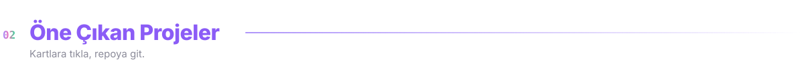

  <a href="https://github.com/yusufKemalPinarci/kelime-bahis">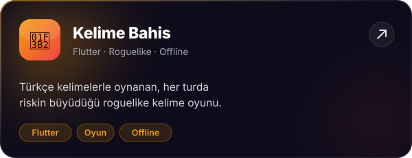</a>
  <a href="https://github.com/yusufKemalPinarci/borc-ejderi">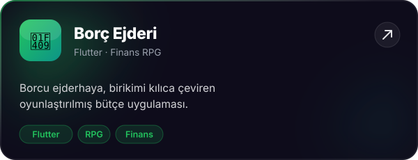</a>

  <a href="https://github.com/yusufKemalPinarci/seviye-ben">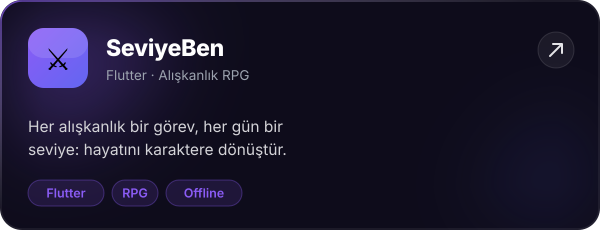</a>
  <a href="https://github.com/yusufKemalPinarci/ruya">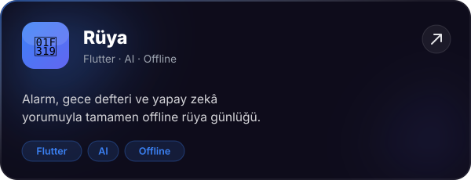</a>

  <a href="https://github.com/yusufKemalPinarci/brewlog">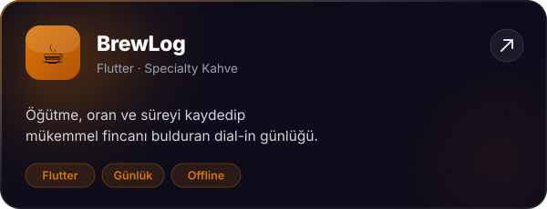</a>
  <a href="https://github.com/yusufKemalPinarci/kuafor_randevu">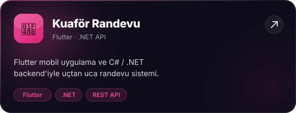</a>

  <a href="https://github.com/yusufKemalPinarci/directional-object-detection">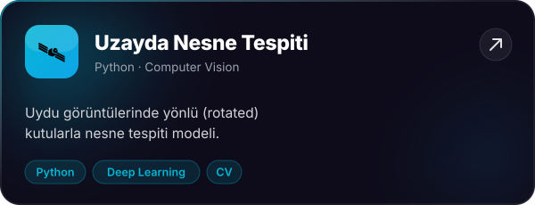</a>
  <a href="https://github.com/yusufKemalPinarci/travel_with_student_web">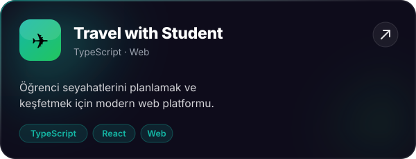</a>

 

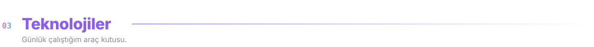

  

 

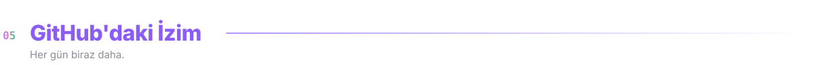

  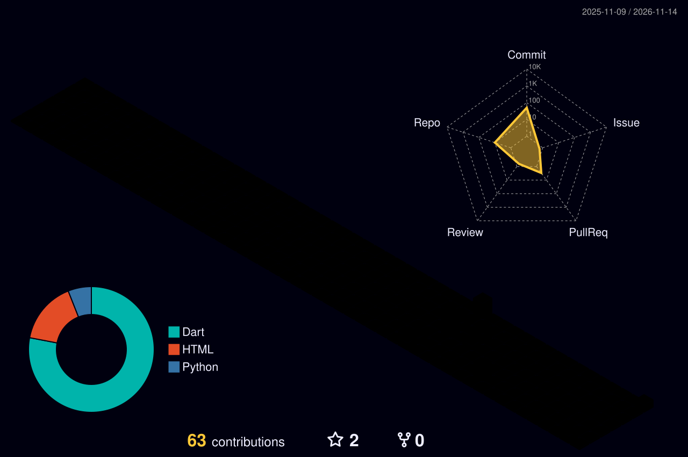

  <picture>
    <source media="(prefers-color-scheme: dark)" srcset="https://raw.githubusercontent.com/yusufKemalPinarci/yusufKemalPinarci/output/github-contribution-grid-snake-dark.svg" />
    
  </picture>

 

